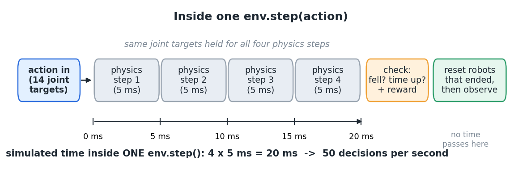

# 08.L01 — What happens in one `env.step()`?

Read the loop from left to right; the orange boxes show today's step through the environment.


## The question

In Module 07 the trainer collected "experience" from the robot. Where does one piece of that experience come from? What exactly does the simulator do when the policy hands it an action?

## The big picture

A reinforcement-learning (RL) **environment** is a simulator wrapped so that it speaks the policy's language. It takes an action in and gives numbers back. The wrapper repeats one function, `env.step(action)`, over and over. Today we look inside one step and then repeat it on MicroDuck. Every later lesson changes one box of this loop.

> **Key idea:** one `env.step()` takes the policy's action, runs 4 short physics steps (20 ms in total), then returns a new observation, a reward, and whether the episode ended.

## How it works

Look first at the four physics blocks: the robot moves while the requested joint angles stay fixed.



Read it left to right:

1. **Action in.** For MicroDuck the action is 14 numbers, one per controlled joint. Each one is an offset (radians) added to that joint's default pose. That gives a **joint target**: the angle the joint's motor should try to reach.
2. **Physics.** The motors push toward those targets while gravity and ground contact act. MuJoCo, the physics engine, advances 5 ms at a time. It does this 4 times with the same targets. These timings come from this task's configuration: the policy chooses targets once per 20 ms of simulated time.
3. **Check and score.** An **episode** is one run from a start pose until an ending condition is met. This task's configuration ends it when the robot tilts past 70°, or when its 20 s time limit runs out. The environment also computes the **reward**: a number saying how good this step was.
4. **Reset, then observe.** Any robot copy that ended is put back at a start pose immediately. Then every copy's sensors are turned into the next **observation**: the 61 numbers the policy will see next.

The same thing as code, simplified from the installed mjlab source (`mjlab/envs/manager_based_rl_env.py`, `step`):

```python
def step(action):                       # action: [num_robots, 14]
    set_joint_targets(default_pose + action)
    for _ in range(4):                  # 4 x 5 ms = 20 ms of simulated time
        physics_step()                  # motors, gravity, contacts
    ended_fail = tilt > 70 degrees      # "terminated"
    ended_time = time >= 20 s           # "truncated" (time up)
    reward = compute_step_reward()     # how the task scores this result
    reset(robots where ended_fail or ended_time)   # each robot on its own
    obs = read_sensors_and_build_observation()
    return obs, reward, ended_fail, ended_time
```

**Parallel copies.** The environment runs many independent copies of the robot at once (`num_envs`). Each copy has its own body, its own episode and its own reset. One call to `step` advances all of them by 20 ms.

<details><summary>Optional: where these numbers come from in the source</summary>

- 5 ms physics step and 4 substeps: printed by the lab from `env.physics_dt` and `env.cfg.decimation`. They are configured in `mjlab_microduck/tasks/microduck_velocity_env_cfg.py`.
- Action = offset from default pose, scale 1.0: `joint_pos_action.scale = 1.0` in the same file (around line 273).
- Fall limit of 70°: the `fell_over` termination in `mjlab/tasks/velocity/velocity_env_cfg.py` (around line 379).
- 20 s time limit (1000 steps): printed by the lab as `episode_length_s`.

</details>

## Run it

In a terminal in the course folder (on Windows, type `.\lab` in place of `./lab.sh`):

```
./lab.sh 08/L01
```

The first run can take a few minutes while simulation code compiles. This lab uses a **constant policy**: a rule that always outputs zero, ignoring the sensor readings. Every joint therefore tries to hold its default angle for 4 seconds. Four robot copies run side by side; there is no learned balancing behavior.

You will get, in `lessons/L01-one-env-step/results/default/`:

- **`robot.gif`**: robot copy 0 seen by a camera. The caption shows simulated time and tilt; a **red** caption marks an ending at or just before that frame. Look first at how the robot leans before it falls.
- **`signals.png`**: three panels for all four copies, sharing the time axis: trunk height, tilt (with the 70° limit dashed in red), and reward per step. Dotted vertical lines mark episode endings.
- **The printed table**: the first steps in detail, then one row per episode ending, with the reason.

At an ending, the displayed height and tilt already belong to the reset pose; the ending flag and reward describe the step that just ended.

## Change one thing

| Try | Command | Watch for |
|---|---|---|
| Random joint targets instead of holding still | `./lab.sh 08/L01 action_noise=0.3` | Do random actions keep it up, or make it fall sooner? |
| Turn off the training randomness (pushes, randomized mass and friction) | `./lab.sh 08/L01 config=play` | Is the fall caused by the random pushes, or would it fall anyway? |
| More robot copies | `./lab.sh 08/L01 num_envs=16` | Each copy falls and restarts at its own time |

`results/compare.png` overlays copy 0's tilt for every setting you have tried.

## What it means

The joint controllers try to hold a fixed pose, but this does not keep MicroDuck balanced in this test. The robot tips, crosses the fall limit, and the environment ends that episode and restarts it. Each step returns readings, a score and an ending flag that training can use to improve a policy. In the earlier teacher test, all four copies first fell within about 1.2–1.5 s, with or without the training randomness.

This lab does not show *why* the default pose is unstable (the actuator limits and weight distribution would need a separate look). It also does not show any training.

## Transfers to other robots

- On another simulated robot task, look for action in → physics → observation, reward, ended out. Check the physics time step, how many physics updates happen per decision, and the episode time limit.
- "What does an action mean?" is always worth checking. Here it is an offset from a default pose, in radians. On another robot it might be a torque, a velocity, or a target position.

## Sources

- [mjlab](https://github.com/mujocolab/mjlab) 1.3.0 (Apache-2.0): `mjlab/envs/manager_based_rl_env.py` (`step`), `mjlab/tasks/velocity/velocity_env_cfg.py`. The pseudocode above is a simplified paraphrase of `step`.
- [microduck_rl](https://github.com/pollen-robotics/microduck_rl) by Pollen Robotics (Apache-2.0): `src/mjlab_microduck/tasks/microduck_velocity_env_cfg.py` (task configuration).
- Robot GIFs made by this lab on your machine are renderings of the MicroDuck 3D model (© Pollen Robotics, CC BY-NC-SA). They stay in `results/` and are not part of this repository. See `CREDITS.md`.

## New terms

- **environment**: the simulator plus the code that turns it into observation, reward and ended signals for a policy.
- **episode**: one run of a robot copy from reset until it ends.
- **policy step / physics step**: one decision (20 ms here) versus one physics update (5 ms here). Several physics steps make one policy step.
- **joint target**: the angle a joint's motor is told to reach. It is not the angle the joint actually reaches.

Next: **08.L02 — How do episodes end and restart?**
