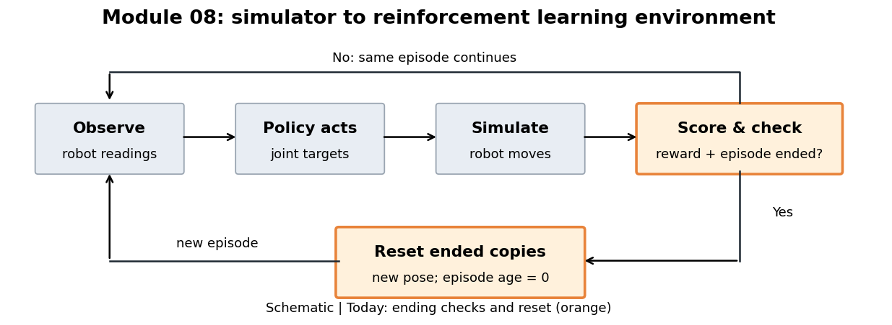

# 08.L02 — How do episodes end and restart?

Read the loop from left to right. The orange boxes show today's part: deciding when a robot's run ends and giving that copy a fresh start.



## The question

MicroDuck tips over while another simulated copy is still standing. Should both restart? What if a copy reaches its time limit before falling?

## The big picture

The environment turns simulated robot readings into an observation; the policy uses it to choose joint targets. After the robot moves, the environment scores the result and checks whether its episode ended. Today we follow that ending check back to reset, which supplies a fresh starting observation for the next action.

> **Key idea:** Keep the reason an episode ended, and reset only the copies that ended.

## How it works

An **episode** is one run from a starting state until an ending; it lets us separate successive attempts. Here the robot tries to hold its default joint pose, but that fixed command does not keep it balanced.

**Terminated** means a task ending condition occurred. Here a fall triggers it: the configured check is trunk tilt beyond 70 degrees from upright, not whether the robot has already hit the floor.

**Truncated** means the run was cut short by an external limit. Here we focus on the time limit: it ends an episode even if the robot has not fallen.

A **reset** puts an ended copy back at a start state and sets its episode age to zero. The other copies continue their own episodes.

Follow this simplified pseudocode for each copy, after the simulated movement:

```python
terminated = task_ending_condition(copy)  # e.g. fell over
truncated = external_limit_reached(copy)  # e.g. time up
record_ending_flags(terminated, truncated)
if terminated or truncated:
    reset(copy)
return observation_of(copy)              # new start if reset happened
```

In this installed environment, reset happens inside `step()`: its ending flags describe the old episode, while its returned observation already describes the new start.

<details><summary>Optional: source checks and other ending reasons</summary>

Read-only installed source (find the folder with `lab py tools/where.py mjlab`; line numbers are for mjlab 1.3.0):

- `mjlab/envs/manager_based_rl_env.py:372`: `step()`; counters, ending checks, automatic reset of selected copies, then observations.
- `mjlab/envs/mdp/terminations.py:19`: time-out check against maximum episode steps; `:24`: orientation check.
- `mjlab/tasks/velocity/velocity_env_cfg.py:377`: time limit is a truncation; fall limit is 70 degrees. Leaving the terrain is also classified as a truncation, so `truncated` does not universally mean time ran out.
- `mjlab/managers/termination_manager.py:102`: each condition contributes to one flag group. Both flags can be true on the same step; the lab preserves both.

The lab changes only the episode time limit on the loaded configuration. Training randomization remains enabled. It records ending conditions directly, rather than trying to infer falls from the post-reset pose.

</details>

## Run it

We use independent copies of MicroDuck holding the default pose so their falls and fresh starts are visible. For this lab we choose 16 copies, a 1.3-second episode limit, and 2.6 seconds of total simulated time; these are demonstration settings, not training recommendations.

In a terminal in the course folder (on Windows, type `.\lab` in place of `./lab.sh`):

```powershell
./lab.sh 08/L02
```

Open the outputs in this lesson's `results/default/` folder:

| Output | Where to look first |
|---|---|
| `robot.gif` | Watch copy 0 tip and jump back to a starting pose. The red caption marks an ending; the rendered pose is already reset. |
| `endings.png` | Follow one row: each marker ends an episode for that copy. Then compare rows to see which copies continue when another resets. |
| `summary.json` | Read the actual ending reasons and each episode's age at its ending. |

Red crosses mark task endings, blue dots mark external cutoffs, and purple diamonds mean both happened on the same step.

The lab checks that ended copies have age zero, other copies advance one step, and time-outs occur at the configured episode limit.

## Change one thing

Keep the robot commands unchanged and shorten the episode limit:

| Try | Command | Watch for |
|---|---|---|
| Less time before reset | `./lab.sh 08/L02 episode_seconds=0.6` | Time-outs can reset the robot before it reaches the fall condition. |

Open `results/compare.png`: start with each drop to zero in copy 0's episode age. The horizontal axis keeps advancing across episodes; each drop begins a new attempt. Each setting also keeps its own animation and ending timeline.

## What it means

A reset is bookkeeping as well as a change of pose: a new attempt starts for one copy. The ending flags preserve why its previous attempt stopped. A short time limit can prevent a visible fall without improving the robot's balance.

This lab demonstrates episode handling, not a learned balancing policy.

## Transfers to other robots

- Define the task's own ending conditions: a failure here could be a success in another task.
- Preserve task endings and external cutoffs separately, even when both lead to reset.
- Check whether your environment resets automatically and which episode its returned observation belongs to.

## Sources

- [mjlab](https://github.com/mujocolab/mjlab) 1.3.0 (Apache-2.0): `mjlab/envs/manager_based_rl_env.py`, `mjlab/envs/mdp/terminations.py`, `mjlab/managers/termination_manager.py`, `mjlab/tasks/velocity/velocity_env_cfg.py`.
- [microduck_rl](https://github.com/pollen-robotics/microduck_rl) by Pollen Robotics (Apache-2.0): the walking task configuration.
- Robot GIFs made by this lab on your machine are renderings of the MicroDuck 3D model (© Pollen Robotics, CC BY-NC-SA). They stay in `results/` and are not part of this repository. See `CREDITS.md`.

## New terms

- **Terminated:** the task reached an ending condition, such as failure or success.
- **Truncated:** an external limit cut the run short, such as its time allowance.
- **Automatic reset:** the environment starts a new episode for an ended copy inside its step call.

Next lesson: where does the reward number come from?

