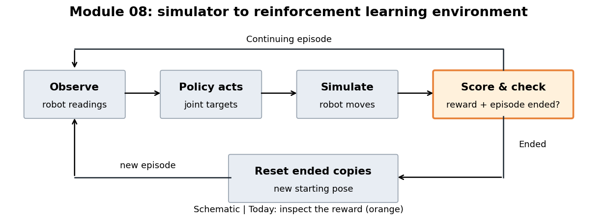

# 08.L03 — Where does the reward number come from?

Follow the loop from the robot's readings to its next movement. The orange box is today's focus: how that movement gets scored. This is a schematic, not a simulation result.



## The question

MicroDuck starts with its feet on the ground and its joints driven toward the default pose. It tips and eventually falls in this experiment. How does the environment turn what it did into one reward number?

## The big picture

The policy, the rule that chooses joint targets, receives robot readings and sends an action. The simulator moves the robot; the environment scores the result and checks whether the episode ended. During reinforcement learning (RL), the trainer uses these rewards to improve the policy's choices. Today we inspect that score without training a policy.

> **Key idea:** The reward is the sum of named contributions; inspecting the parts reveals what behavior the task encourages and penalizes.

## How it works

A **reward term** measures one aspect of behavior, such as staying upright or changing joint targets. Splitting the score into terms lets us see why it changed.

A **reward weight** is a signed multiplier chosen in the task settings. It controls how strongly a term contributes; for a nonnegative term, a negative weight makes it a penalty.

Read this pseudocode from top to bottom. The installed task includes step duration when turning each term into its contribution.

```python
reward = 0
for term in configured_terms:
    value = term.measure(robot_state, commands, action_history)
    contribution = value * term.weight * step_seconds
    reward += contribution
return reward
```

Start with these two parts in the lab:

| Physical connection | Source name | Contribution in this task |
|---|---|---|
| The trunk stays close to upright | `upright` | Positive; shrinks as the robot tilts away from upright |
| Joint targets change between decisions | `action_rate_l2` | Negative; larger target changes incur a larger penalty |

The second term measures changes in **requested targets**, not measured joint speed. Other terms reward matching motion commands or penalize unwanted motion and contact; the lab retains every active term in the sum.

<details><summary>Optional: the formula and a small worked calculation</summary>

The calculation combines differently measured behaviors into a single score:

\[
c_i = w_i f_i\Delta t, \qquad r = \sum_i c_i.
\]

| Symbol | Meaning | Units and shape |
|---|---|---|
| \(i\) | Index of a named term | Integer index |
| \(f_i\) | Raw term value for this robot and step | Scalar; units depend on the term |
| \(w_i\) | Signed weight for that term | Scalar; converts its value to reward units per second |
| \(\Delta t\) | Simulated duration of one decision step | Scalar, seconds |
| \(c_i\) | This term's contribution | Scalar, reward units |
| \(r\) | Reward returned for this step | Scalar, reward units |

The weight sets the sign and size of each contribution. The time factor scales the score by how long a decision step lasts. A zero term or zero weight contributes nothing. Reward units are an arbitrary score, not a physical measurement such as energy.

For a small **illustration**, imagine only two terms: an upright score and a target-change cost. The following raw values and weights are hand-picked to make the arithmetic clear; they are not measured MicroDuck results. Use raw values \(f_u=0.8\), \(f_a=0.5\), weights \(w_u=2\), \(w_a=-0.1\), and duration \(\Delta t=0.02\) seconds.

First expand the sum:

\[
r = c_u+c_a = (w_u f_u)\Delta t + (w_a f_a)\Delta t.
\]

Then compute each contribution:

\[
c_u=(2\times0.8)\times0.02=1.6\times0.02=0.032,
\]
\[
c_a=(-0.1\times0.5)\times0.02=-0.05\times0.02=-0.001.
\]

Finally add them: \(r=0.032+(-0.001)=0.031\) reward units. The penalty reduces the positive contribution. The actual lab adds every active term, not just these two.

Installed source checked for this lesson:

- `mjlab/managers/reward_manager.py:116–131`: multiply by weight and time, then accumulate. Its diagnostic `_step_reward` omits the time factor; `duckkit` restores it for the saved contributions.
- `mjlab/envs/mdp/rewards.py:60–68`: `action_rate_l2` sums squared differences between current and previous raw actions.
- `mjlab/tasks/velocity/mdp/rewards.py:67`: upright score implementation.
- MicroDuck `src/mjlab_microduck/tasks/microduck_velocity_env_cfg.py:300,349`: upright and initial action-change weights.

</details>

## Run it

In a terminal in the course folder (on Windows, type `.\lab` in place of `./lab.sh`):

```powershell
./lab.sh 08/L03
```

The chosen demonstration settings run four robot copies for two simulated seconds, holding default joint targets. This is a fixed policy that does not react to tipping; it is not trained balancing.

Open the outputs in `results/default/` in this order:

1. **`robot.gif`** — watch copy 0 tip. A red caption marks an ending/reset; the shown pose is already after the reset.
2. **`reward_parts.png`** — the left panel shows mean contributions for all terms. On the right, look first at the green upright contribution as the robot tips; red is the target-change contribution. Green + red + blue equals the black total. Dotted lines mark copy 0's endings.
3. **`terms.csv`** — all names, weights and mean contributions, for lookup. `summary.json` records both numerical checks; `signals.npz` contains the step-by-step measurements.

The lab checks that the terms add to the returned reward on every step. It separately checks the target-change contribution against recorded actions before each copy's first reset.

## Change one thing

Now replace fixed targets with randomly changing targets:

| Try | Command | Watch for |
|---|---|---|
| Random joint-target offsets | `./lab.sh 08/L03 action_noise=0.3` | More changing targets in the GIF; a negative target-change contribution in the plot |

Here `0.3` radians is the chosen standard deviation, the typical size of the random offsets. Each decision draws new offsets around the default targets. The run keeps the same seed and duration; the movement and subsequent resets can differ.

After both runs, `results/compare.png` places their mean contributions side by side. Look at **Target changes** first, then **Returned total**. These are averages over all steps and copies, including falls and resets.

## What it means

A total can hide a positive reward for one behavior and a penalty for another. Inspecting named contributions tells us which part changed and whether it matches the behavior we intended to score. Changing targets also changes the motion, so several parts can change together.

This experiment explains the score; it does not establish good reward weights or demonstrate learned walking.

## Transfers to other robots

- Record named contributions beside the total so you can diagnose unexpected scores.
- Check the raw term's meaning, sign and typical size together with its weight; weights alone do not reveal which term dominates.
- Check whether that environment includes step duration before comparing its per-step scores.

## Sources

- [mjlab](https://github.com/mujocolab/mjlab) 1.3.0 (Apache-2.0): `mjlab/managers/reward_manager.py`, `mjlab/tasks/velocity/mdp/rewards.py`.
- [microduck_rl](https://github.com/pollen-robotics/microduck_rl) by Pollen Robotics (Apache-2.0): reward terms and weights of the walking task configuration.
- Robot GIFs made by this lab on your machine are renderings of the MicroDuck 3D model (© Pollen Robotics, CC BY-NC-SA). They stay in `results/` and are not part of this repository. See `CREDITS.md`.

## New terms

- **Reward term:** one measurable part of the behavior used to build the score.
- **Reward weight:** a signed multiplier controlling a term's contribution.

Next lesson's question: what does the policy actually see?

