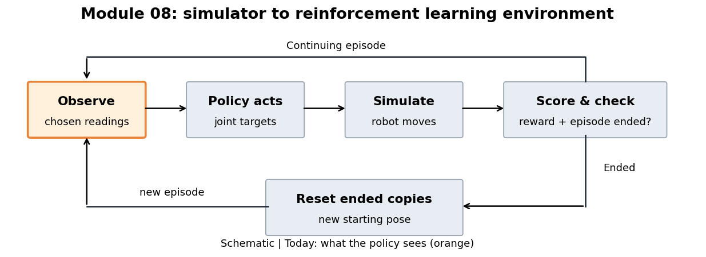

# 08.L04 — What does the policy actually see?

Start at the orange **Observe** box: it decides which information can influence the next action. Follow the arrows to see where that information is used.



## The question

MicroDuck tips while its motors try to hold a fixed pose. The simulator knows the robot's motion and foot contacts. Which of those facts reach the rule choosing joint targets?

## The big picture

The environment builds an observation, the policy chooses joint targets, and the simulator moves the robot. The environment scores the result, checks for an episode ending, and builds the next observation. Today we inspect the **observation**: the chosen list of numbers supplied for a decision.

> **Key idea:** The policy receives selected, processed readings and commands, while the training critic can receive extra information.

## How it works

The **actor** is the policy that chooses actions. Its input contains both measurements and instructions about what to do.

The **critic** predicts future reward to help train the actor. Its separate input can include simulator information that the actor does not receive directly.

Read this schematic from left to right; the two branches serve different jobs:

```text
Robot state + commands + previous action
    |
    +-- select and process actor inputs --> actor --> next joint targets
    |
    +-- select critic inputs, including extra facts --> critic
                                                       |
                                                training feedback
```

For this walking task, the configured pieces are below. Counts describe the installed interface; you do not need to memorize them.

| Information | Actor | Critic |
|---|---|---|
| Trunk rotation rate and gravity direction | Yes | Yes |
| Joint angles relative to default pose, and joint speeds | Yes | Yes |
| Previous action and requested motion / poses | Yes | Yes |
| Trunk linear velocity | Absent | Yes |
| Foot height, time in air, contact and contact force | Absent | Yes |
| Total numbers | 61 | 76 |

“Absent” means no direct input slot; other readings may still provide clues about that quantity. Shared term names do not guarantee identical values in both groups.

**Projected gravity** is the downward direction expressed along the robot's own axes. It gives a tilt cue: when upright, its z component is near −1; as the trunk tips, that component moves toward zero. This direction has no units.

**Observation noise** is a random change added to a reading to imitate imperfect sensing. Here we compare the actor's gravity input with the simulator's gravity direction at the same instant.

```python
# Schematic for this lab's gravity channel only.
true_direction = robot.gravity_direction_in_body_axes
actor_gravity = true_direction + random_reading_error
critic_gravity = true_direction
```

## Run it

The lab simulates MicroDuck holding fixed joint targets until it tips and resets. Hand-picked settings keep it short: four copies, 1.6 seconds; the animation follows copy 0. No policy is trained.

The gravity channel's delay and mounting error are disabled in this teaching configuration so the plotted difference isolates noise.

In a terminal in the course folder (on Windows, type `.\lab` in place of `./lab.sh`):

```powershell
./lab.sh 08/L04
```

Open these in `results/default/`:

1. `robot.gif`: watch the trunk tip, then return to a reset pose.
2. `observations.png`: look first at the upper panel. Orange is the actor's reading; black is the simulator's direction, also supplied to the critic. The lower panel magnifies their difference on a fixed comparison scale.
3. `layout.json`: optional reference for each group's ordered pieces and slots. The terminal prints the pieces side by side.

Red dotted lines mark episode endings; readings on those steps already describe the reset robot.

## Change one thing

The default gravity noise is the source-configured uniform range ±0.01 per component. The larger range below is hand-picked to make the difference easy to see.

| Try | Command | Watch for |
|---|---|---|
| Enlarge reading noise | `./lab.sh 08/L04 gravity_noise=0.15` | Orange strays farther from black; the lower-panel error grows. |

`results/compare.png` overlays the reading errors from your saved runs.

## What it means

The selected input slot follows the physical tilt, but its value can differ from simulator truth. The printed layout shows another choice: some simulator facts have no actor slot at all.

This lab demonstrates input construction, not the effect of noise on learned balance: its fixed action ignores observations.

## Transfers to other robots

- Trace each policy input back to a sensor, an estimate, a command or action history.
- Check each input's order, units and processing when connecting a trained policy to a new runtime.
- Keep information available only during training out of any actor input that cannot be supplied on the real robot.

<details><summary>Optional: source and exact processing</summary>

The source repository is read-only. This lab changes a copied runtime configuration.

- `src/mjlab_microduck/tasks/microduck_velocity_env_cfg.py:531–633`: removes actor linear velocity, defines actor noise/delays/mounting effects, selects actuated joints and enables actor encoder bias.
- Same file, `:691–701`: appends head and body commands to both groups.
- Installed `mjlab/tasks/velocity/velocity_env_cfg.py:76–164`: base observation groups, including critic foot information and disabled critic additive noise.
- Installed `mjlab/managers/observation_manager.py:321–384`: term function → noise → clipping → scaling → delay/history → concatenate in configured order. The lab's gravity scale is one.
- The actor and critic network configs enable observation normalization (`microduck_velocity_env_cfg.py:913–926`), which rescales inputs using running statistics. The plots here show environment outputs **before** that network-side step.

Other actor channels retain their normal training processing. Turning off gravity noise does not make the entire actor observation equal to simulator state. The full ordered layouts are saved separately because actor and critic offsets differ.

</details>

## Sources

- [mjlab](https://github.com/mujocolab/mjlab) 1.3.0 (Apache-2.0): the observation manager and the velocity task's observation terms.
- [microduck_rl](https://github.com/pollen-robotics/microduck_rl) by Pollen Robotics (Apache-2.0): actor and critic observation groups of the walking task configuration.
- Robot GIFs made by this lab on your machine are renderings of the MicroDuck 3D model (© Pollen Robotics, CC BY-NC-SA). They stay in `results/` and are not part of this repository. See `CREDITS.md`.

## New terms

- **Actor:** the policy that chooses actions from its input.
- **Observation noise:** random changes applied to readings to imitate imperfect sensing.
- **Privileged information:** information available during training that is not supplied to the acting policy.

Next lesson: how do many robots' steps become one training batch?

