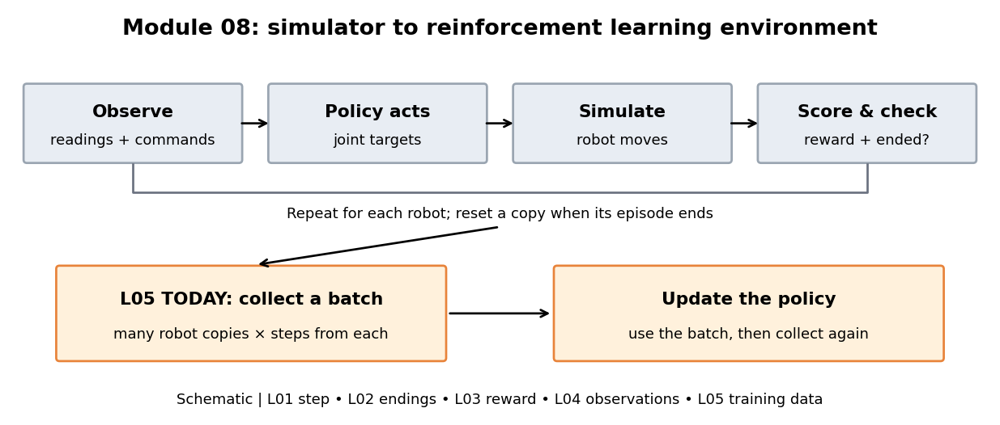
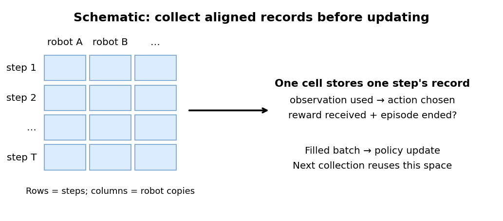

# 08.L05 — How do steps become training data?

Follow the robot loop across the top, then look at the orange boxes: today we connect its steps to policy training.



## The question

Many simulated MicroDucks move at once, each choosing joint targets and receiving a score. How much of that experience does the trainer collect before changing the policy?

## The big picture

Each robot observes, acts, moves, and receives a reward and an episode-ending flag. The trainer saves these records from every copy in a **batch**: the collection of experience it will use for the next policy update. After collecting a fixed number of steps per copy, it updates the policy and collects again.

> **Key idea:** a collected training batch contains one record for every robot at every collected step; changing the robot count changes how much experience feeds each update.

## How it works

A **transition** is one record from one step of one robot: the observation used, the action chosen, the reward received, and whether its episode ended. The trainer stores each field under the same step and robot indices so they stay attached to the same event.

Look down robot A's column first. Each row adds its next step; the other columns hold the other robots' steps. This is a schematic of storage, not a measured run.



A **training iteration** is one collect-then-update cycle. Here, an update uses Proximal Policy Optimization (PPO), the policy-improvement method from Module 07; its internal calculations stay inside the update box today.

```python
# Simplified collection; each row contains all robot copies.
observation = environment.current_observation()
for iteration in training:
    batch = empty_storage()  # previous iteration's records are no longer needed
    for step in collection_steps:
        action = policy(observation)
        next_observation, reward, ended = environment.step(action)
        batch[step, :] = record(observation, action, reward, ended)
        observation = next_observation
    update_policy(batch)
```

The storage starts empty and fills in time order. A robot that ends resets independently; its next record stays in the same column, with the ending marked on the previous record. Filling the batch does not itself reset the robots.

<details><summary>Count the records in this lab</summary>

We count records to know how much newly collected experience feeds one update.

\[
B = N T
\]

| Symbol | Meaning | Units / type |
|---|---|---|
| B | Records in one collected batch | record count, scalar |
| N | Robot copies | robot count, scalar |
| T | Steps collected from each copy | steps per robot, scalar |

Every step adds one record from every robot. Therefore the number of rows times the number of columns gives the total.

The lab uses a deliberately small robot count to keep training short. Its default is 64 copies; the installed MicroDuck trainer configuration supplies 24 steps per copy.

\[
B = N T = 64 \times 24 = 64 \times (20 + 4)
  = 1280 + 256 = 1536\text{ records}.
\]

Changing only the robot count to 32 gives:

\[
B = N T = 32 \times 24 = 640 + 128 = 768\text{ records}.
\]

The shorter batch contains half as many records, while each copy still contributes the same number of steps. An iteration includes multiple internal optimization steps; it is not one parameter adjustment.

The real trainer also stores value estimates and action-probability information used by the update; the schematic shows the fields needed to follow collection.

Source: installed `mjlab_microduck/tasks/microduck_velocity_env_cfg.py:947` supplies the collection length; `rsl_rl/runners/on_policy_runner.py:83–108` collects, computes training targets, then updates. `rsl_rl/storage/rollout_storage.py:141–149` allocates the step-by-robot arrays. The lab checks these dimensions at runtime.

</details>

## Run it

In a terminal in the course folder (on Windows, type `.\lab` in place of `./lab.sh`):

```powershell
./lab.sh 08/L05
```

This starts a fresh policy and runs five short training iterations on real MicroDuck simulation. Motors follow the sampled joint targets while gravity and ground contact act; copies can tip and reset. The figures inspect the records from those movements.

The lab typically takes under three minutes after caches are warm. It logs locally and caps the settings at a short run.

In `results/default/`, open:

- **`batch.png`** first: the actual last batch's occupied cells. Read down one robot column. A red cross marks an ending; the next cell belongs to that copy's reset episode.
- **`batches.csv`**: one row per completed collect/update cycle. Compare “records” with “cumulative records.”
- **`summary.json`**: counts checked against storage, environment calls, and the trainer's independent total.
- **`training.log`**: the full local trainer output. Its iterations are numbered from zero; the lesson table counts completed cycles from one.

`results/compare.png` shows how the cumulative record count grows across your runs. `last_batch.npz` holds the final batch's observation, action, reward and ending arrays for optional inspection.

## Change one thing

| Try | Command | Watch for |
|---|---|---|
| Fewer robot copies | `./lab.sh 08/L05 num_envs=32` | The grid keeps the same number of rows but has half as many columns; the count added per iteration halves. |

Open `results/compare.png` after both runs. Start at the first completed cycle: the curves separate because each update receives a different number of newly collected records.

## What it means

Changing the robot count changes the data budget per update, even when the number of training iterations stays fixed. Each robot still contributes the same short stretch of steps. The lab counts newly collected records; reusing them inside the update does not collect more experience.

Five iterations verify the training loop, not learned walking quality or which robot count learns best.

## Transfers to other robots

- Count robot copies and collected steps together when comparing training budgets.
- Preserve the step and robot indices across every stored field.
- Check another trainer's collection length and reset behavior; batch completion and episode completion are separate events.

## Sources

- [rsl_rl](https://github.com/leggedrobotics/rsl_rl) (BSD-3-Clause): the PPO runner, rollout storage and update that the lab instruments.
- [mjlab](https://github.com/mujocolab/mjlab) 1.3.0 (Apache-2.0): `mjlab/rl` (environment wrapper and runner).
- [microduck_rl](https://github.com/pollen-robotics/microduck_rl) by Pollen Robotics (Apache-2.0): `src/mjlab_microduck/tasks/microduck_velocity_env_cfg.py` (training settings).
- J. Schulman et al., *Proximal Policy Optimization Algorithms*, 2017, https://arxiv.org/abs/1707.06347.

## New terms

- **Collected training batch:** the set of step records gathered for the next policy update.
- **Training iteration:** one cycle of collecting experience and updating the policy.

Next: Module 09 — reproduce and evaluate a walking baseline. How can we tell whether a trained policy walks reliably?

