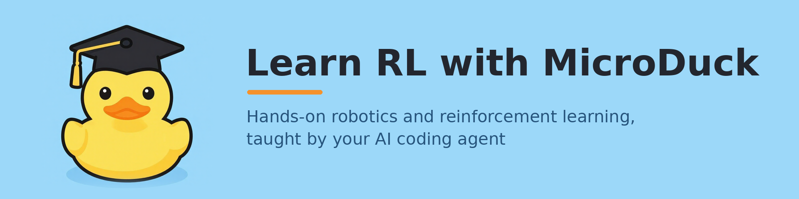
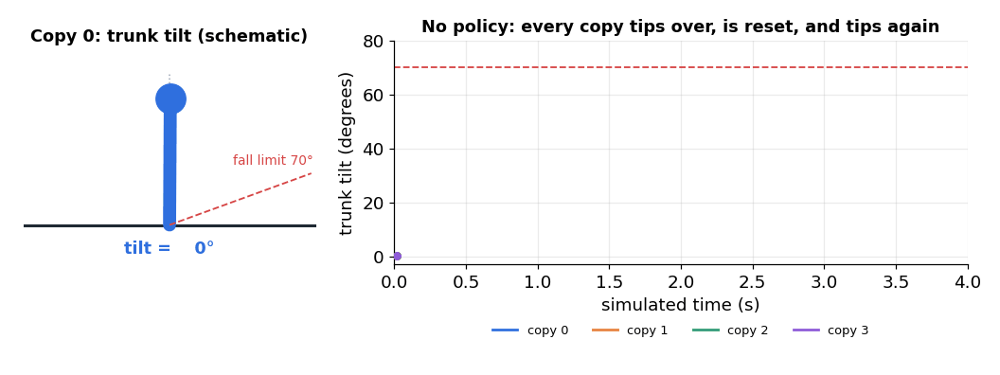
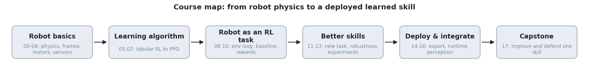
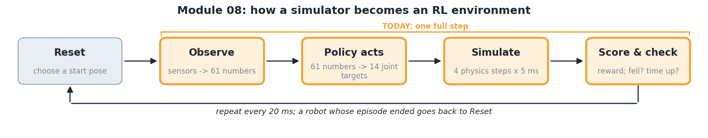
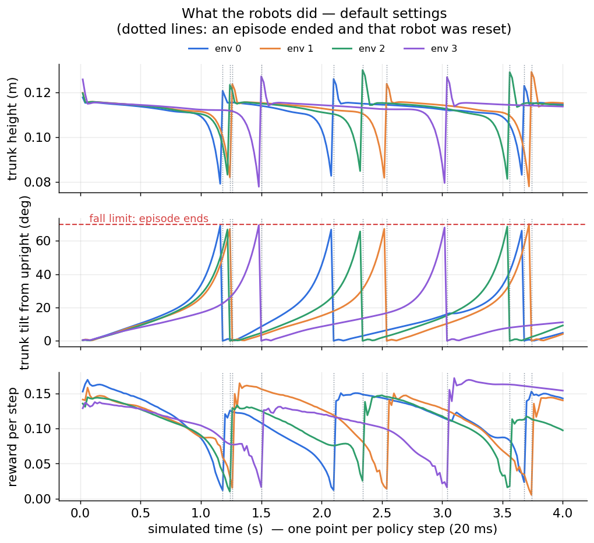

# Learn Reinforcement Learning with MicroDuck

**A hands-on robotics and reinforcement-learning course taught by your AI coding agent, on a real open-source walking robot, in simulation on your own computer.**

You open this folder in an AI coding agent (Codex, Claude Code, Gemini CLI, …). The agent becomes your teacher. It explains one idea at a time, starting from the big picture, and gives you a small experiment to run on a simulated [MicroDuck](https://github.com/pollen-robotics/microduck) robot. You look at the result together, you change one setting, and you see what happens.



*Real data from a Module 08 lab, drawn as a schematic. With no controller reacting to its sensors, every simulated robot tips over within about a second and the training environment resets it. Seeing why is the start of understanding what a learned policy has to do. On your own machine the lab also shows the simulated robot itself.*

## What you will learn

The course goes from "what is a feedback loop?" to training, evaluating and exporting a walking policy for a real robot design. MicroDuck is the worked example; the goal is skills you can use on any robot.



| Stage | Modules | You will be able to… |
|---|---|---|
| Robot basics | 00–04 | read a robot model, reason about physics, frames, motors, sensors and state estimation |
| Learning algorithm | 05–07 | implement tabular RL and policy gradients, and explain PPO (the algorithm that trains the robot) step by step |
| Robot as an RL task | 08–10 | inspect a training environment, evaluate a walking policy honestly, and design and debug rewards |
| Better skills | 11–13 | build a new task with a curriculum, test robustness, and run fair experiments |
| Deploy and integrate | 14–16 | export a policy, verify it, and run it inside the robot's real control software in simulation |
| Capstone | 17 | improve one behavior and defend the result with evidence |

The full curriculum is in [LearningPlan/LEARNING_PLAN.md](LearningPlan/LEARNING_PLAN.md). Plan for roughly 130–175 hours at your own pace; every module is useful on its own.

**Who it is for:** you can read and run Python and remember some linear algebra, calculus and probability. No robotics or machine-learning background is needed, and no physical robot. The agent asks about your background in the first session and adapts.

## What a lesson looks like

1. **Big picture first.** Every lesson opens with a map of the whole process, with today's part highlighted.

   

2. **One key idea, shown with a diagram or pseudocode** instead of a wall of text.

   

3. **You run the lab.** One command; a few minutes.

   ```
   lab 08/L01
   ```

4. **You look at the result together**, then change one thing and compare:

   ```
   lab 08/L01 action_noise=0.3
   ```

   

5. **Wrap-up:** what it means, and what carries over to other robots. Progress is saved automatically.

There are no quizzes and no grades. Ask anything at any time. If the teaching style does not suit you, say so: the agent records your feedback and adapts.

## Quick start

**1. Get the course**

```
git clone https://github.com/JianZhongDev/LearnRLWithMicroDuck.git
cd LearnRLWithMicroDuck
```

If you want to keep your progress under version control, fork the repository first (or use it as a template) and clone your copy.

**2. Run setup** (once; 10–30 minutes, several GB of downloads)

| System | Command | Notes |
|---|---|---|
| Windows 10/11 | `.\setup` in PowerShell | Runs inside WSL 2. If WSL is missing: `wsl --install -d Ubuntu` in an Administrator PowerShell, restart, then run `.\setup` again. |
| Linux (Ubuntu, Fedora, …) | `./setup.sh` | Needs `git` and `curl`. |
| macOS (Apple Silicon) | `./setup.sh` | Simulation on the CPU; the Apple GPU is used for neural-network-only lessons. Not yet tested; see [docs/ENVIRONMENT.md](docs/ENVIRONMENT.md). |

You can also let your agent do this: open the folder in the agent and type `setup-environment` (see step 3 for the prefix). It explains each step and asks before doing anything.

**This repository does not contain MicroDuck's code.** Setup gets the two upstream repositories, [microduck_rl](https://github.com/pollen-robotics/microduck_rl) and [microduck](https://github.com/pollen-robotics/microduck), as separate checkouts *outside* this folder: next to it by default, or wherever you say with `--sources <folder>`. If you already have clones, they are reused and never modified. Setup then creates a private Python environment, checks your compute and rendering, and runs a short simulation. It installs nothing system-wide except the [`uv`](https://docs.astral.sh/uv/) package manager if you do not have it. It finishes with `READY`.

**3. Start learning**

Open the folder in your agent and type:

| Agent | Type |
|---|---|
| Codex (app, CLI or IDE extension) | `$start-course` |
| Claude Code | `/start-course` |
| Gemini CLI, Antigravity, Grok, others | `start-course` |

After the first session, each lesson starts in a new session with `teach-lesson continue` (same prefix). [START_HERE.md](START_HERE.md) is the one-page guide to what to type in every situation.

## What you need

| | Recommended | Minimum |
|---|---|---|
| Computer | NVIDIA GPU with 8 GB+ memory | A 64-bit PC without an NVIDIA GPU, or an Apple Silicon Mac: the simulation runs on the CPU, so labs are smaller and training lessons (Module 09 on) become short demonstrations |
| System | Windows 10/11 with WSL 2, or Linux | macOS on Apple Silicon |
| Disk | 25 GB free | 20 GB |
| AI agent | Codex or Claude Code | Any coding agent that can read files and run commands in a folder |

**Tested so far:** Windows 11 + WSL 2 (Ubuntu) with a 16 GB NVIDIA GPU, taught with Codex, including a CPU-only run of a lab on the same machine. Setup is written to also handle native Linux and Apple Silicon Macs, and instruction files are included for Claude Code, Gemini CLI, Antigravity and Grok, but those combinations have not been tested yet. Reports and fixes are very welcome; see [docs/ENVIRONMENT.md](docs/ENVIRONMENT.md).

**About Apple Silicon:** the robot simulation cannot use the Apple GPU. The simulation library ([NVIDIA Warp](https://github.com/NVIDIA/warp)) runs on NVIDIA CUDA GPUs or on the CPU, and supports Apple Silicon as CPU-only. The course uses the Apple GPU where it can: PyTorch's MPS backend for neural-network-only lessons, and macOS OpenGL for rendering.

## How it works

- **The agent teaches from files.** [AGENTS.md](AGENTS.md) tells any agent how to teach; `.agents/skills/` holds step-by-step procedures (plan a module, teach a lesson, build a lab, answer a question, save progress). `CLAUDE.md`, `GEMINI.md` and `.claude/skills/` make the same instructions visible to other agents.
- **The course remembers for you.** `LearningProgress/STATE.md` records where you are, so every session can start fresh. Your profile is in `LearningProgress/LEARNER.md`.
- **Lessons are prepared for you.** The curriculum is fixed, but the agent writes each lesson page and lab when you reach it, adapted to your background and your machine, and tests the lab before giving it to you. Module 08 ships with five ready-made lessons that set the standard.
- **Labs use the real thing.** `duckkit` (in `LearningProgress/_shared/`) wraps the actual MicroDuck training environment, so labs are a few readable lines.
- **Honest by design.** The agent is told never to invent results and never to claim you understood something you did not show.

More detail: [docs/ARCHITECTURE.md](docs/ARCHITECTURE.md).

## Repository layout

```
README.md  START_HERE.md        for you
AGENTS.md  CLAUDE.md  GEMINI.md for the agent
setup.sh / setup.cmd            one-time setup
lab.sh / lab.cmd                run a lab:  lab 08/L01
.agents/skills/                 the teaching procedures (mirrored in .claude/skills/)
LearningPlan/                   curriculum, teaching rules, examples of good and bad lessons
LearningProgress/               your course: state, profile, glossary, one folder per module
docs/                           environment guide, architecture, images, mascot artwork (docs/assets/)
tools/                          environment check and maintenance scripts
CREDITS.md                      sources, licenses and acknowledgments
```

Not in this repository: the MicroDuck code (separate checkouts made by setup, outside this folder), the Python environment, and your lab results.

## Starting over, updating, sharing

- **Start over:** `git restore LearningProgress LearningPlan` resets the tracked course files. Add `git clean -fd LearningProgress` to also delete lessons and results your agent created. Both commands discard your progress.
- **Update the course:** commit your progress, then `git pull`. Your progress lives in a few tracked files (`STATE.md`, `LEARNER.md`, `GLOSSARY.md`, notes), so keep it on your own branch or fork to avoid conflicts.
- **Share a lesson you liked:** lesson pages and labs are plain files under `LearningProgress/<module>/lessons/`. Pull requests that add tested, well-made lessons for other modules are welcome.

## Credits and license

This course stands on other people's work. Full details, licenses and references are in [CREDITS.md](CREDITS.md).

- **MicroDuck**, its robot model, its training code and its runtime software are by [Pollen Robotics](https://github.com/pollen-robotics) and contributors ([microduck_rl](https://github.com/pollen-robotics/microduck_rl), [microduck](https://github.com/pollen-robotics/microduck); code under Apache-2.0, 3D model files under Creative Commons BY-NC-SA). This course is an independent, unofficial learning project. It is not affiliated with or endorsed by Pollen Robotics, and it does not redistribute their code.
- **Simulation and learning stack:** [MuJoCo](https://github.com/google-deepmind/mujoco) and [MuJoCo Warp](https://github.com/google-deepmind/mujoco_warp) (Google DeepMind), [NVIDIA Warp](https://github.com/NVIDIA/warp), [mjlab](https://github.com/mujocolab/mjlab), [rsl_rl](https://github.com/leggedrobotics/rsl_rl) (Robotic Systems Lab, ETH Zurich), [BAM](https://github.com/Rhoban/bam) actuator models (Rhoban), and [PyTorch](https://pytorch.org/).
- **Ideas taught:** the algorithms come from the research literature, including PPO and GAE (Schulman et al.) and the textbook by Sutton and Barto; see the reference list in CREDITS.md.
- **License:** everything in this repository is released under the [MIT License](LICENSE): use it, adapt it, translate it and teach with it freely, keeping the copyright notice. The repository contains no images of the robot. Robot animations that labs create on your machine are renderings of Pollen Robotics' 3D model and fall under that model's Creative Commons terms if you share them.

AI teachers make mistakes. Labs run real code so you can check claims against results; when something looks wrong, ask the agent to show its evidence.
